# ProcureFlow

ProcureFlow is an autonomous multi-agent enterprise procurement platform that transforms plain-language purchase requests into governed, policy-compliant purchase orders in about a minute or two. Instead of routing requests through days of fragmented spreadsheets, policy PDFs, supplier portals, and email threads, a coordinated team of seven specialized AI agents (`Orchestrator`, `Policy`, `Budget`, `Vendor`, `Approval`, `Execution`, and `Auditor`) plans the workflow, verifies enterprise procurement policies, atomically reserves department budgets in INR (`₹`), ranks approved suppliers, autonomously re-plans around stock-outs, escalates exceptions to human approvers, issues purchase orders, and seals every action into a tamper-evident SHA-256 hash-chained audit trail.

## Screenshots

Add the following screenshots under `docs/screenshots/`:
- `docs/screenshots/01-dashboard-overview.png`
- `docs/screenshots/02-new-request-natural-language.png`
- `docs/screenshots/03-live-agent-trace-replan.png`
- `docs/screenshots/04-vendor-comparison-matrix.png`
- `docs/screenshots/05-human-approval-queue.png`
- `docs/screenshots/06-tamper-evident-audit-log.png`

## Problem Statement

In modern enterprises, an ordinary procurement request passes through 4 to 6 people and 3 to 4 disconnected tools—policy PDF manuals, department budget spreadsheets, supplier portals, email approval threads, and ERP systems. This fragmented process routinely takes several business days, suffers from inconsistent policy enforcement, risks duplicate or unapproved spend, and leaves behind no unified, tamper-evident audit trail. When an item is out of stock or an approval stalls, manual re-routing adds further delays and administrative overhead.

## Solution Overview

ProcureFlow replaces manual, fragmented procurement workflows with a seven-agent pipeline governed by deterministic code guardrails. Employees submit what they need in plain English (or click a pre-built scenario), and the system streams every agent thought, tool call, tool result, decision, confidence score, and autonomous re-plan live over Server-Sent Events (SSE). Routine compliant requests complete end-to-end without human intervention, while high-value or high-risk requests pause cleanly for one-click Manager or Finance approval and resume live from persisted state.

## Key Features

- **Live Agent Trace (SSE + Polling Fallback):** Real-time timeline displaying the execution plan, per-step agent reasoning, tool invocations, JSON outputs, confidence bars, fallback badges, and vendor comparison matrices.
- **Autonomous Re-planning on Failure:** When a top-ranked supplier fails a live stock check (`check_stock`), the `Orchestrator` automatically excludes the out-of-stock vendor, increments `replan_count`, and re-runs vendor evaluation with an amber **"Recovered automatically"** badge.
- **Manual vs ProcureFlow Impact Panel:** Side-by-side comparison on the run trace and dashboard contrasting typical manual process assumptions (handoffs, tools, wait days) against actual agent active execution time, steps, tool calls, and automated verifications.
- **Pre-Flight Preview Card & Voice Input:** Real-time debounced preview on the request form computing category, estimated cost range, expected approval route, and policy/budget warnings deterministically without LLM calls. Built-in voice input via Web Speech API (`en-IN`).
- **Smart Alternatives on Rejection:** On budget rejection, deterministically computes the maximum affordable quantity at the cheapest approved supplier with a one-click resubmission button. On policy blocks, displays all permitted procurement categories.
- **Quote Savings Calculation & PO PDF Export:** Deterministic savings calculation vs highest approved quote and next-best vendor, displayed across the PO card, approver brief, and dashboard KPI. One-click PO print / PDF export via print stylesheets.
- **Executive Approver Brief:** Displays key metrics (headline, total, vendor, savings, risk flags, confidence) and quick-comment chips on approval cards for fast decision-making.
- **Replay at 4x:** Interactive client-side playback simulating agent execution steps sequentially at 4x speed for demonstrations.
- **Human-in-the-Loop Governance:** Low-risk purchases (`<= ₹50,000`) auto-approve, while mid-tier (`₹50,001–₹2,50,000`), high-value (`> ₹2,50,000`), or risk-adjusted purchases pause for Manager or Finance approval and resume idempotently upon decision.
- **Deterministic Code Guardrails ("LLM proposes, code disposes"):** TypeScript guardrails enforce non-negotiable rules—approval levels can only be raised (never lowered), unapproved vendors are strictly excluded, vendor ranking uses a fixed weighted formula, and budget reservations execute atomically via PostgreSQL row-locked RPCs.
- **Tamper-Evident SHA-256 Audit Chain:** Every state transition is recorded via the `append_audit_log` PostgreSQL RPC under an advisory lock (`pg_advisory_xact_lock`), chaining each row's `prev_hash` and `entry_hash` while database triggers reject `UPDATE`, `DELETE`, and `TRUNCATE`.
- **Analytics & Time-Saved Tracking:** Real-time dashboard showing department budget utilization (`spent`, `reserved`, `available`), run resolution breakdowns (including Failed and Awaiting Approval), spend by category, estimated savings, and active agent work time saved vs. manual procurement baselines.

## How the Agents Work

ProcureFlow orchestrates **7 specialized agents**, each restricted to a strict server-side tool allow-list with `userId`, `role`, `department`, `requestId`, and `runId` bound in code:

1. **Orchestrator Agent:** Parses natural-language procurement requests into structured fields (`category`, `item_description`, `quantity`, `estimated_unit_cost`, `urgency`, `justification_quality`) and generates the 6-step execution plan. Coordinates autonomous re-planning (up to `MAX_REPLANS = 2`) if downstream stock verification fails.
2. **Policy Agent:** Invokes `get_policy_rules` and `list_policy_violations_hint` to enforce prohibited items (such as gift cards or cash equivalents, `is_blocked: true`), category spend caps (`auto_approve_limit`, `manager_limit`), minimum quote requirements (`min_quotes`), and justification thresholds (`requires_justification_above`).
3. **Budget Agent:** Invokes `get_department_budget` during the pre-quote check phase and verifies whether `available = total_budget - spent_amount - reserved_amount` covers the purchase. Once the exact vendor quote is selected, deterministic code atomically reserves the exact quoted total via the `reserve_budget` PostgreSQL RPC.
4. **Vendor Agent:** Queries candidate suppliers via `search_vendors`, evaluates historical orders via `get_past_orders`, and checks live inventory via `check_stock`. Deterministic code computes `priceScore`, `deliveryScore`, `ratingScore`, and `riskScore` (`0.45 * price + 0.25 * delivery + 0.20 * rating + 0.10 * risk`), excludes unapproved or out-of-stock vendors, and selects the winner.
5. **Approval Agent:** Evaluates request risk and routing via `computeRequiredRoute`. Deterministic code enforces thresholds from the `policies` table (`total <= auto_approve_limit` → `auto`, `total <= manager_limit` → `manager`, `> manager_limit` → `finance`) plus upward-only risk adjustments (`vendor.risk_level === 'high'` requires `finance`, `medium` raises by one step, `auto` requires `low` risk) and policy floors (`total > requires_justification_above` without justification or `quotes < min_quotes` raises route to at least `manager`).
6. **Execution Agent:** Issues the official Purchase Order (`PO-2026-XXXXXX`) via `create_purchase_order`, commits the reserved funds to `spent_amount` via `commit_budget`, and dispatches confirmation messages to the requester and vendor via `send_notification`.
7. **Auditor Agent:** Runs on every terminal run (`completed` or `rejected`), inspects the full run summary via `get_run_summary`, verifies policy/budget/approval consistency, and writes an executive audit narrative.

## Architecture

```mermaid
flowchart TB
    subgraph Client["React 18 + Vite Client (Vercel)"]
        UI["Pages: Dashboard, New Request, Live Run Trace, Approvals, Vendors, Audit"]
        SSEClient["SSE Client (@microsoft/fetch-event-source + Polling Fallback)"]
    end

    subgraph Server["Node.js + Express + TypeScript API (Render)"]
        AuthMW["JWT Auth + Role Guard + Rate Limiter"]
        Orch["Orchestrator & 7-Agent Pipeline"]
        Guard["Deterministic Guardrails (Routing, Vendor Ranking, Budget Math)"]
        Tools["Per-Agent Tool Registry (Context-Bound)"]
        SSEHub["SSE Event Bus"]
    end

    subgraph External["AI & Cloud Persistence"]
        Gemini["Google Gemini API (@google/genai) + Mock/Fallback Runtime"]
        Supabase["Supabase PostgreSQL (RLS Deny-All + Atomic RPCs + Hash-Chain Triggers)"]
    end

    UI -->|REST JSON + Bearer JWT| AuthMW
    SSEClient -->|GET /api/runs/:id/stream| SSEHub
    AuthMW --> Orch
    Orch --> Guard
    Orch -->|Structured JSON + Function Calling| Gemini
    Orch --> Tools
    Tools -->|Service Role Key| Supabase
    Orch --> SSEHub
```



## Tech Stack

- **Frontend:** React 18, TypeScript, Vite, Tailwind CSS v3, React Router v6, Axios, Recharts, Lucide React, `@microsoft/fetch-event-source`
- **Backend:** Node.js 20+, Express.js, TypeScript, `@google/genai` (official Google Gemini SDK), `@supabase/supabase-js`, `pg`, `jsonwebtoken`, `bcryptjs`, `zod`, `helmet`, `cors`, `express-rate-limit`
- **Database:** Supabase Cloud PostgreSQL with `pgcrypto`, Row Level Security (RLS) deny-all public policies, atomic stored procedures (`reserve_budget`, `commit_budget`, `release_budget`, `append_audit_log`), and immutability triggers
- **Testing:** Vitest (`npm test`) and end-to-end scenario runner (`npm run test:scenarios`)

## Prerequisites

- **Node.js** 20+ and **npm**
- **Git**
- A **Supabase** project with automatic RLS enabled
- A **Google Gemini API key** from Google AI Studio (optional for offline testing when `LLM_MODE=mock`)

## Local Setup

1. Clone the repository and install dependencies for both `/server` and `/client`:
   ```bash
   git clone https://github.com/<your-username>/<your-repo>.git
   cd <your-repo>
   npm run install:all
   ```

2. Copy both `.env.example` files to `.env`:
   ```bash
   cp server/.env.example server/.env
   cp client/.env.example client/.env
   ```

3. Fill in `server/.env`:
   - `SUPABASE_URL` and `SUPABASE_SERVICE_ROLE_KEY`: Found in your Supabase Dashboard under **Project Settings → API Keys**.
   - `SUPABASE_DB_URL`: Found in your Supabase Dashboard under **Connect → Session pooler** connection string (recommended for IPv4 networks).
   - `GEMINI_API_KEY`: Create one in **Google AI Studio → Get API key**.
   - `JWT_SECRET`: Generate a strong secret using:
     ```bash
     node -e "console.log(require('crypto').randomBytes(48).toString('hex'))"
     ```
   - `LLM_MODE`: Set to `live` to use Gemini or `mock` for deterministic offline execution.

4. Check `client/.env`:
   - `VITE_API_BASE_URL=http://localhost:4000`

## Database Migration

Apply the database schema and seed data (`supabase/migrations/001_initial_schema.sql`) using either option below:

- **Option A — Automated CLI Migration (requires `SUPABASE_DB_URL` in `server/.env`):**
  ```bash
  npm --prefix server run migrate
  ```

- **Option B — Supabase SQL Editor (works even if direct PostgreSQL ports are blocked on your network):**
  1. Open your Supabase Dashboard → **SQL Editor**.
  2. Paste the entire contents of `supabase/migrations/001_initial_schema.sql` and click **Run**.

- **Verify & Seed Demo Users:**
  1. In the Supabase **Table Editor**, confirm the 10 tables exist (`users`, `budgets`, `vendors`, `policies`, `requests`, `agent_runs`, `agent_steps`, `approvals`, `purchase_orders`, `notifications`, `audit_logs`).
  2. Seed the five demo users with bcrypt password hashes:
     ```bash
     npm --prefix server run seed:users
     ```

## Run Locally

Start the backend and frontend in two terminals:

- **Terminal 1 — Backend API (`http://localhost:4000`):**
  ```bash
  npm run dev:server
  ```

- **Terminal 2 — Frontend App (`http://localhost:5173`):**
  ```bash
  npm run dev:client
  ```

- **Offline / Mock Mode:** Set `LLM_MODE=mock` in `server/.env` to run the entire 7-agent pipeline deterministically without making network calls to Gemini.

## Demo Credentials

All demo accounts share the password **`Demo@1234`** (available as one-click buttons on the `/login` page):

| Role | Email | Department | Password |
|---|---|---|---|
| Employee (Design) | `employee@procureflow.demo` | Design | `Demo@1234` |
| Manager (Design) | `manager@procureflow.demo` | Design | `Demo@1234` |
| Finance Controller | `finance@procureflow.demo` | Operations | `Demo@1234` |
| Employee (Engineering) | `eng.employee@procureflow.demo` | Engineering | `Demo@1234` |
| Employee (Marketing) | `mkt.employee@procureflow.demo` | Marketing | `Demo@1234` |

## Demo Scenarios

Reset demo state at any time with:
```bash
npm --prefix server run seed:reset-demo
```

Run all six scenarios automatically end-to-end with:
```bash
npm run test:scenarios
```

| # | Account | Prompt | Expected Outcome |
|---|---|---|---|
| **1** | `employee@procureflow.demo` (Design) | `"Order 20 ergonomic office chairs for the Design studio."` | `OfficeMart India` selected at `₹8,500` × 20 = `₹1,70,000` (`WorkSpace Interiors` is `₹9,200` × 20 = `₹1,84,000`). Total exceeds Furniture `requires_justification_above` (`₹1,00,000`) without justification, raising route floor to **manager**. Manager approves (`manager@procureflow.demo`; employee self-approval returns 403), PO is created, and `₹1,70,000` is committed. |
| **2** | `employee@procureflow.demo` (Design) | `"10 laptops for the new design team, around ₹12 lakh, needed in 3 weeks."` | `QuickDeals Traders` (`₹85,000`) excluded (`"Vendor not approved"`). `TechNova Systems` (`₹98,000`) ranked #1 initially, but `check_stock` fails (`available_qty = 4 < 10`). **Orchestrator re-plans** (`replan_count = 1`, amber `"Recovered automatically"` badge), excludes `TechNova Systems`, and selects `Prime Infotech` (`₹1,04,000` × 10 = `₹10,40,000`, 7 days) over `Globex Distribution` (`₹95,000`, 21 days, medium risk). Escalates to **finance** (exceeds IT Hardware `manager_limit` of `₹5,00,000`). After `finance@procureflow.demo` approves, PO is issued. |
| **3** | `eng.employee@procureflow.demo` (Engineering) | `"Buy 5 annual project-management software licenses for Engineering."` | `SoftSuite Reseller` selected (`₹4,800` × 5 = `₹24,000`). Within Software Licenses `auto_approve_limit` (`₹25,000`), low vendor risk, no policy floor → **auto-approved** (`completed`) with zero human clicks, PO created, notifications sent, and time saved recorded. |
| **4** | `employee@procureflow.demo` (Design) | `"Purchase 200 gift cards worth ₹500 each as employee rewards."` | **Policy Agent blocks** the request (`Prohibited Items` category, `is_blocked: true`). Run terminates immediately as `rejected`, budget is untouched (`0` budget steps), and the Auditor Agent logs the compliance explanation. |
| **5** | `mkt.employee@procureflow.demo` (Marketing) | `"I need 10 laptops for the marketing team."` | Marketing available budget is `₹1,00,000` (`₹8,00,000` total − `₹7,00,000` spent). Minimum approved catalog estimate (`₹9,50,000`+) exceeds `₹1,00,000` → **Budget Agent rejects** (`insufficient`), no funds remain reserved, and run ends `rejected`. |
| **6** | Verified inside Scenario 2 + `/audit` | QuickDeals exclusion & cryptographic audit integrity | `QuickDeals Traders` appears in the Vendor Comparison Table as **Excluded** (`"Vendor not approved"`), and `GET /api/audit` / `GET /api/audit/verify` confirm `chainValid: true` across the entire SHA-256 hash chain. |

## Testing

- **Typecheck both packages:**
  ```bash
  npm run typecheck
  ```
- **Run unit & guardrail tests (Vitest):**
  ```bash
  npm --prefix server test
  ```
- **Run all 6 end-to-end demo scenarios:**
  ```bash
  npm run test:scenarios
  ```

## Security Notes

- **Row Level Security (RLS) Deny-All:** Every table in Supabase has RLS enabled with `USING (false) WITH CHECK (false)` for `anon` and `authenticated` roles. Only the Express backend (using `SUPABASE_SERVICE_ROLE_KEY`) can access the database.
- **Server-Only Secrets:** The React client never imports `@supabase/supabase-js` or `@google/genai` and contains no API keys.
- **Context-Bound Tools & Guardrails:** Agent tool calls never accept `userId`, `role`, or `department` from the LLM; they are injected by the server from the verified JWT context.
- **Tamper-Evident Audit Chain:** `append_audit_log` acquires `pg_advisory_xact_lock(20260101)` and computes `SHA-256` hashes inside PostgreSQL, while triggers block `UPDATE`, `DELETE`, and `TRUNCATE` on `audit_logs`.
- **Automated Secret Scanner:** Run `npm run check:secrets` before every commit to verify `.env` files are git-ignored and no credentials or keys exist in source files or `client/dist`.

## Push to GitHub

1. Create an **empty** repository on GitHub (do **not** initialize with a README, `.gitignore`, or license) and set its visibility to **Public**.
2. Confirm `git status` does not list any `.env` file, then run these exact commands:

```bash
git config --global user.name "Your Name"
git config --global user.email "your-github-email@example.com"
git init
git add .
git status
npm run check:secrets
git commit -m "ProcureFlow: initial commit"
git branch -M main
git remote add origin https://github.com/<your-username>/<your-repo>.git
git push -u origin main
```

## Deployment

### 1. Render (Backend Web Service)
- **Service Type:** Web Service
- **Environment:** Node
- **Root Directory:** `server`
- **Build Command:** `npm install --include=dev && npm run build`
- **Start Command:** `npm start`
- **Health Check Path:** `/api/health`
- **Node.js Version:** Configured automatically via `.node-version` (`22`) and `package.json` (`"engines": { "node": ">=22" }`). (Alternatively set Render Environment Variable `NODE_VERSION=22`).
- **Environment Variables:**
  | Variable | Value / Description |
  |---|---|
  | `PORT` | `5000` (or leave default for Render to assign) |
  | `NODE_ENV` | `production` |
  | `NODE_VERSION` | `22` |
  | `CLIENT_URL` | Your frontend production URL (e.g. `https://procureflow.vercel.app` with **no trailing slash**) |
  | `JWT_SECRET` | Strong 32+ character random string |
  | `JWT_EXPIRES_IN` | `24h` |
  | `SUPABASE_URL` | `https://<project-ref>.supabase.co` |
  | `SUPABASE_SERVICE_ROLE_KEY` | Supabase service_role key (server-only) |
  | `SUPABASE_DB_URL` | Session pooler connection string (IPv4) from Supabase dashboard |
  | `GEMINI_API_KEY` | Google AI Studio API key |
  | `GEMINI_MODEL` | `gemini-2.5-flash` |
  | `LLM_MODE` | `live` (or `mock` for deterministic test mode) |
  | `LLM_FALLBACK` | `true` |
  | `LLM_RPM` | `8` |

### 2. Vercel (Frontend SPA)
- **Root Directory:** `client`
- **Framework Preset:** `Vite`
- **Build Command:** `npm run build`
- **Output Directory:** `dist`
- **Environment Variables:**
  | Variable | Value / Description |
  |---|---|
  | `VITE_API_BASE_URL` | Your Render service URL with **no trailing slash** (e.g. `https://procureflow-api.onrender.com`) |

> **Note on SPA Routing:** `client/vercel.json` is already configured with `"routes": [{ "src": "/[^.]+", "dest": "/index.html" }]` so refreshing deep links like `/runs/:id` or `/requests/new` will never 404.

### 3. Post-Deploy CORS Alignment
- Once Vercel provides your frontend URL, update `CLIENT_URL` in your Render Environment settings to that exact URL (without trailing slash, e.g. `https://procureflow.vercel.app`) and click **Save Changes** (Render will automatically redeploy).

### 4. Free-Tier Notes
- **Render:** Free web services sleep after 15 minutes of inactivity; the first request can take about a minute or two to wake up, so open `/api/health` before running a live demo or recording.
- **Supabase:** Free projects pause after 7 days of inactivity; restore from the Supabase dashboard if paused.
- **Gemini Quota:** Keep `LLM_FALLBACK=true` in production so rate-limit spikes degrade gracefully with a visible fallback badge instead of failing a demo run.

## Troubleshooting

| Symptom | Cause | Fix |
|---|---|---|
| Render build fails with `tsc: not found` | Render sets `NODE_ENV=production`, skipping `devDependencies` where TypeScript lives | Use Build Command: `npm install --include=dev && npm run build` |
| Browser shows CORS error | `CLIENT_URL` on Render does not match Vercel origin or has a trailing slash | Set `CLIENT_URL` to exact Vercel origin without trailing slash and redeploy |
| Vercel returns `404` on page refresh (e.g. `/runs/:id`) | SPA rewrite missing | Ensure `client/vercel.json` is committed with rewrite `/(.*) -> /index.html` |
| `ENETUNREACH` or timeout during `npm run migrate` | Direct Supabase DB host uses IPv6 (`db.<ref>.supabase.co`) | Use the **Session pooler** IPv4 connection string from Supabase Connect menu, or run `001_initial_schema.sql` in the Supabase SQL Editor |
| Gemini `429 Too Many Requests` | Free-tier RPM limit exceeded | Lower `LLM_RPM=8` in `server/.env` or rely on `LLM_FALLBACK=true` / `LLM_MODE=mock` |
| Gemini `model not found` error | Model identifier deprecated or unavailable in region | Set `GEMINI_MODEL=gemini-2.5-flash` in `server/.env` |
| Live Agent Trace SSE stalls behind proxy | Reverse proxy buffering event stream | Server sets `X-Accel-Buffering: no`; client automatically falls back to polling after SSE error |
| Login succeeds but dashboard/tables are empty | Database migration or user/demo seed scripts were not run | Run `npm --prefix server run migrate`, `npm --prefix server run seed:users`, and `npm --prefix server run seed:reset-demo` |

## Decisions

- **Custom `users` Table with Bcrypt + JWT:** Authentication is managed against the application's `users` table rather than Supabase Auth so all five role-based demo accounts can be seeded deterministically via `npm --prefix server run seed:users` without external email confirmation flows.
- **Two-Phase Budget Handling:** The Budget Agent checks department availability before vendor selection using estimated cost, and once the Vendor Agent selects a concrete supplier quote, deterministic code atomically reserves the exact quoted amount via `reserve_budget` before routing to approval.
- **Deterministic Fallback Badge:** Whenever `LLM_FALLBACK=true` catches a transient Gemini API error or `LLM_MODE=mock` is active, the step records `usedFallback: true` so the UI surfaces a transparent badge without breaking autonomous execution.

## Limitations

- **Single Line-Item per Request:** Each natural-language request is parsed into one primary item category and quantity (`quantity * unit_price`).
- **Mocked ERP & Email Adapters:** Purchase order creation (`PO-2026-XXXXXX`) and supplier/requester email notifications are persisted to the `purchase_orders` and `notifications` PostgreSQL tables rather than calling a third-party ERP or SMTP gateway.
- **Single-Instance SSE Bus:** The in-memory `EventEmitter` SSE hub is designed for a single Render instance; if a client disconnects or connects to another instance, the Run Trace page automatically replays steps from PostgreSQL and polls until completion.

## Pre-submission Checklist

- [ ] GitHub repository is **public** and renders `README.md` cleanly.
- [ ] `npm run check:secrets` passes all checks and `git status` shows no `.env` files.
- [ ] Deployed Vercel link opens in an incognito browser window without CORS or 404 errors.
- [ ] All five demo login buttons work on the deployed site and `npm run seed:reset-demo` has been run before recording.
- [ ] Demo video (3–5 minutes) is uploaded, publicly viewable, and linked below.

## Submission Links

- **GitHub Repository:** https://github.com/muddamkavyasreetpt-gif/ProCure-Flow
- **Deployed Application:** 
- **Demo Video:** 

## License

MIT License — Copyright (c) 2026 ProcureFlow Contributors. See [LICENSE](./LICENSE) for full text.
